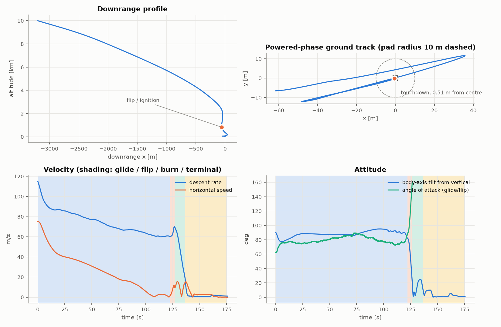
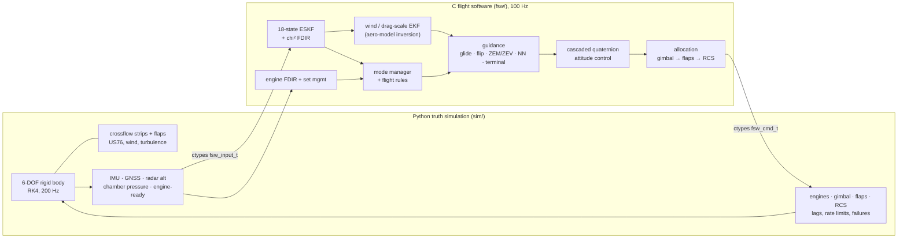
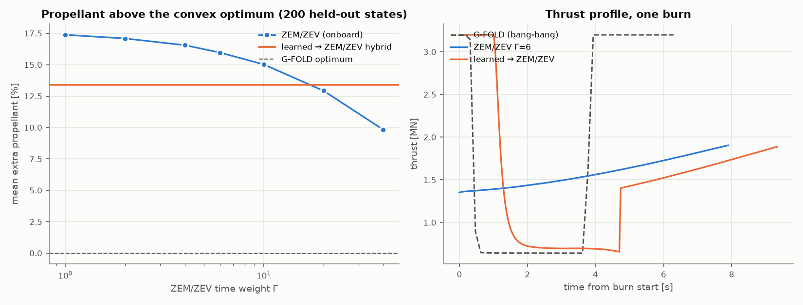
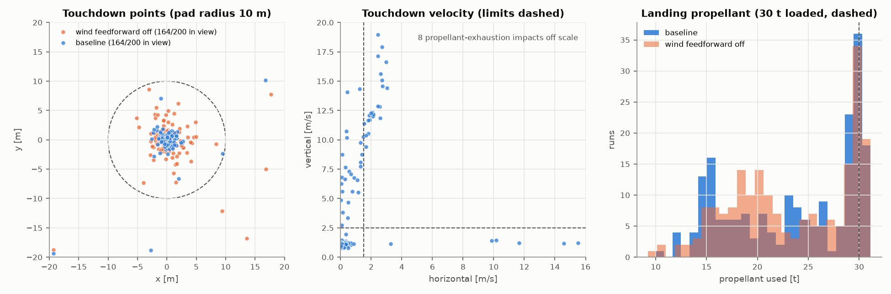
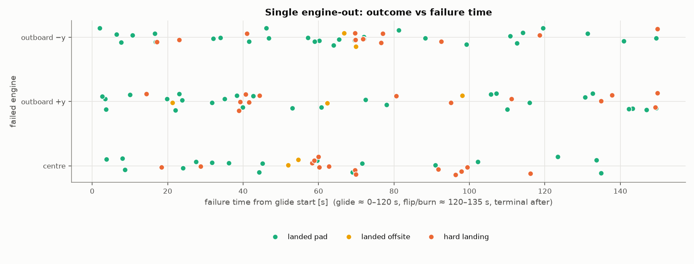

# starship-lander-gnc

Guidance, navigation & control flight software for a **generic belly-flop reusable vehicle** —
flap-steered aerodynamic glide → engine-lit flip → landing burn → vertical terminal descent onto a
10 m pad — with online wind estimation, engine-out handling and abort-to-backup flight rules,
an offline convex-optimal benchmark, and a learned (imitation + DAgger) burn-guidance policy.

> The vehicle is notional (round-number mass, geometry and engine values). It is "Starship-style"
> in its flight profile only and is not a model of any real vehicle.



| | |
|---|---|
| **Flight software** | C99, single precision, no dynamic memory, `-Werror -Wconversion`; ~32 KB code, ~25 KB static RAM; ~10 µs per 100 Hz step on a desktop core |
| **Truth model** | Python 6-DOF: US76 atmosphere, slender-body crossflow aero (Mach/AoA), 4 dihedral flaps, Dryden-like turbulence + shear, engine transients/failures, sensor errors |
| **Software-in-the-loop** | the C FSW is built as `libfsw.so` and flown by the truth model through `ctypes` — the exact code that would fly |
| **Verification** | 194 C unit checks, 20 pytest cases (physics, C/Python model parity, closed-loop SIL), fault sweep, Monte Carlo |

---

## Results at a glance

| Metric (6-DOF SIL Monte Carlo, dispersed) | Result |
|---|---|
| Lands on the 10 m pad (baseline, n=200) | **62.0 %** |
| Pad miss distance when on the pad: median / p95 | **0.77 m / 2.61 m** |
| Touchdown p95: vertical / horizontal speed / tilt | 1.27 m/s / 0.49 m/s / 3.7° |
| Random single engine-out anywhere in flight (n=120) → on pad | **62.5 %** (same as no failure) |
| Wind feedforward on vs off: p95 pad miss (pad-landing rate) | 2.61 m vs 5.61 m (62.0 % vs 66.0 %) |
| Navigation consistency: mean position NEES (3 = ideal) | 2.10 |
| Landing-burn propellant vs convex optimum (point-mass, 200 states) | ZEM/ZEV +16.0 %, learned hybrid +13.4 % |
| Dominant failure: propellant exhaustion after a wind-driven glide miss | 27.5 % of runs |

The headline limitation is stated up front: when strong winds aloft push the glide off target the
landing burn and terminal phase have to recover hundreds of metres and the 30 t load runs out
(see *Known limitations*).

---

## Architecture



### Mission phases (mode manager)

| Mode | What happens | Key logic |
|---|---|---|
| `GLIDE` | belly-first fall at terminal speed (q̄ ≈ 2 kPa), 10 km → ~0.9 km | horizontal ZEM/ZEV → desired aero-force direction → **exact crossflow inversion** to a body attitude; flaps hold it |
| `FLIP` | aerodynamic pitch-up, then engines light | the aft-heavy body pitches itself tail-first; ignite within 35° of the thrust attitude; watchdog |
| `BURN` | landing burn on 2 engines (latched to 1 when light) | ZEM/ZEV with optimal time-to-go and aero/wind feedforward (or learned policy → ZEM/ZEV) |
| `TERMINAL` | centre engine, 40 m gate → touchdown at 1 m/s | velocity-profile descent, lateral hold, hover-translate, lateral-speed taper |
| aborts | engine-out / unsurvivable | < 2 engines before ignition → backup site; stopping margin ≥ 0.8 → backup; non-survivable → steer impact away from pad |

---

## Guidance, navigation & control design

### Navigation — 18-state error-state Kalman filter (`fsw/src/nav.c`)
* States: position, velocity, attitude (body-frame error), gyro bias, accel bias, **GNSS Gauss-Markov bias**.
  Without the bias states the filter was visibly overconfident (errors outside 3σ): 10 Hz updates
  average white noise but not a correlated bias, so R-inflation cannot fix it. With them, the nominal
  run's errors stay inside 3σ ([figure](docs/figures/nominal_nav.png)).
* Updates: GNSS position/velocity, dual-antenna radar altimeter (belly / aft boresight, slant-range model
  with analytic attitude Jacobian, verified against central differences).
* **Vector χ² gating (Cholesky) + sequential scalar updates** — no matrix inverse on board. A sensor rejected
  20 times in a row is latched failed (GNSS step-spoof and stuck-radar faults are isolated in the fault sweep).

### Wind estimation without air data (`fsw/src/wind_est.c`)
A 3-state EKF (horizontal wind + crossflow drag scale) whose measurement is the **IMU specific force**,
predicted through the onboard aero model from `R^T (v − w)`; thrust is reconstructed from chamber pressure
so it keeps estimating during powered flight, where lateral wind loads remain observable against the
well-known lateral thrust. Observability is anisotropic in the glide (wind along the nose barely changes
the crossflow; σ ≈ 2.6 vs 0.9 m/s), and the estimate is extrapolated to lower altitude with a 1/7
power-law profile. It feeds the guidance drift term, the terminal feedforward and the glide aim point.

### Guidance (`fsw/src/guidance.c`)
* **Glide — exact crossflow inversion.** For an axisymmetric slender body the normal force is
  perpendicular to the axis and in the plane of axis and airspeed. Requiring it along a desired direction
  `n` gives the body axis in closed form, `x ∝ v_air − (v_air·n) n` (sign chosen for minimum slew);
  verified against the aero model in a unit test. AoA is envelope-limited to 90 ± 20°.
* **Ignition logic** — engine-count-aware stopping distance + flip time + margin, so an engine lost in the
  glide automatically moves the flip higher.
* **Landing burn — ZEM/ZEV** (Ebrahimi 2008, Guo 2013) with time-to-go minimising
  `Γ·t + ½∫|a|²` (closed-form double-integrator energy; grid + golden section, Bellman-bounded
  re-optimisation), predicted aero acceleration in the drift term, and an upper bound on time-to-go that
  rules out energy-optimal-but-absurd hop-and-divert solutions.
* **Thrust projection** onto the tilt cone and magnitude annulus with vertical priority.
* **Pointing the thrust vector, not the body.** With an off-centre engine set the gimbal must trim the
  thrust line through the CoM; the attitude target is rotated by the geometric trim (computed from chamber
  pressure, not from the control loop — feeding back the commanded gimbal created a loop that diverged).

### Control (`fsw/src/control.c`)
* Cascaded quaternion attitude control: eigen-axis outer loop with a `√(2αθ)` deceleration envelope, inner
  rate loop with integrator and gyroscopic compensation, predicted body aero moment cancelled.
* Powered-flight bandwidth is set by the **gimbal rate limit** (30°/s ≈ 1 s stop-to-stop): a 5 rad/s inner
  loop produced a ±15°/s limit cycle; the tuned loop (outer 0.8, inner 3.5 rad/s) was chosen by a seed sweep.
* Allocation: common 2-axis gimbal (cancels engine-out offset torque) → **bounded, redistributed
  pseudo-inverse over four flaps** about a trim exposure → RCS residual.

---

## Learned guidance (AI) and the convex-optimal benchmark

**G-FOLD reference** (`analysis/gfold.py`): lossless convexification (Açıkmeşe & Ploen 2007) solved with
Clarabel, free final time by golden section. The thrust annulus is [1 engine at min, 2 at max] — a relaxation
of the engine-count logic, so its optimum is a **lower bound** on landing-burn propellant. It recovers the
expected bang-bang structure (~0.5 s per solve).

**Learned policy** (`analysis/learned_guidance.py`, `fsw/src/nn_policy.c`):
1. 500 G-FOLD trajectories → 20 k (state → optimal thrust-acceleration) pairs;
2. behaviour cloning of an 8-64-64-3 tanh MLP (numpy, Adam);
3. **DAgger**: roll the learned policy out through the *C inference code*, query the expert at the states it
   actually visits, aggregate, retrain (3 iterations, +4.8 k labels);
4. export a 4 953-parameter float32 blob; on board: fixed 4.8 k MAC, ~3.8 µs, no allocation.

| Law | extra propellant vs G-FOLD (mean / p95) | gate success (<1 m, <1 m/s) | mean gate |Δv| |
|---|---|---|---|
| ZEM/ZEV, Γ = 1 | +17.4 % / +23.1 % | 98.0 % | 0.35 m/s |
| ZEM/ZEV, Γ = 6 (flight) | +16.0 % / +21.2 % | 96.0 % | 0.36 m/s |
| ZEM/ZEV, Γ = 20 | +12.9 % / +17.0 % | 93.5 % | 0.43 m/s |
| ZEM/ZEV, Γ = 40 | +9.8 % / +13.2 % | 88.5 % | 0.44 m/s |
| learned MLP alone | +30.9 % / +235.4 % | 3.5 % | 3.77 m/s |
| learned → ZEM/ZEV hybrid | +13.4 % / +32.1 % | 97.0 % | 0.37 m/s |



**Findings.** Imitating a bang-bang optimum is fragile: the network reproduces the propellant use but its
switch-timing errors leave ~3–4 m/s at the gate, and with no feedback it occasionally stalls in a hover. The
deployable design is a **hybrid with a runtime monitor**: the network shapes the burn, and a verified feedback
law (ZEM/ZEV, re-initialised) takes the last ~3 s — or takes over immediately if the network stops descending.
That keeps ZEM/ZEV's gate precision while cutting the mean optimality gap. The remaining gap sits in the final
max-thrust arc that is handed to the smooth feedback law; a residual policy on top of ZEM/ZEV or a smoothed
(fuel + ε·energy) expert are the obvious next steps.

---

## Monte Carlo (full 6-DOF SIL)

Dispersions: glide-start state (100 m, 3 m/s), propellant ±2 %, inertia ±5 %, per-engine thrust ±1.5 %,
Isp ±1 %, thrust misalignment, CoM offset, crossflow/axial/flap coefficients ±8–10 %, density ±3 %,
temperature ±5 K, surface wind 0–12 m/s and aloft wind 5–30 m/s in random directions, turbulence 0.5–3 m/s,
IMU/GNSS/radar error realisations.

| Campaign | n | on pad | soft, off pad | miss median / p95 | propellant | prop. exhausted | >100 m off | nav NEES |
|---|---|---|---|---|---|---|---|---|
| baseline | 200 | 62.0 % | 6.5 % | 0.77 / 2.61 m | 23.6 t | 27.5 % | 6.0 % | 2.10 |
| wind feedforward off | 200 | 66.0 % | 6.0 % | 1.36 / 5.61 m | 23.4 t | 25.5 % | 4.5 % | 2.26 |
| random engine-out | 120 | 62.5 % | 5.8 % | 0.63 / 1.99 m | 24.1 t | 30.0 % | 3.3 % | 2.24 |
| learned → ZEM/ZEV burn | 80 | 17.5 % | 6.2 % | 0.80 / 3.21 m | 21.5 t | 48.8 % | 3.8 % | 2.14 |

Mean wind aloft in runs that reached the pad: 14.8 m/s; in runs that did not: 20.7 m/s. The wind estimate at ignition has a median error of 5.4 m/s (truth includes turbulence), which is good enough for the terminal feedforward (it halves the p95 miss) but does not rescue a glide that is already out of reach; the upwind aim offset it adds even costs a few percent of pad landings in strong-wind runs, so the aim-point use should be gated on estimate confidence. The learned burn policy, trained in the aero-free point-mass harness, transfers poorly to full 6-DOF flight: the hybrid monitor keeps landings precise when it lands, but the network's long low-thrust arcs cost time and propellant under real aero and attitude dynamics, so it is a research result here, not the flight default.




---

## Embedded footprint (`make -C fsw size bench`)

| Item | Value |
|---|---|
| Code size (`-Os`, x86-64 proxy for flash) | ~32.5 KB text across 9 modules (nav 4.2 KB, guidance 5.6 KB, executive 7.8 KB) |
| Static RAM | ~24.7 KB `.bss` (20 KB of it the 4 953-parameter network; ESKF 2.9 KB) — no heap, no recursion |
| `fsw_step`, full 100 Hz frame (glide, GNSS 10 Hz, radar 20 Hz, wind EKF 20 Hz) | 5.0 µs mean, 45 µs worst on a desktop core (0.05 % of the 10 ms frame; ~0.5–1 % on a 400–600 MHz Cortex-M7) |
| 18-state ESKF propagation (dense ΦPΦᵀ) | 3.1 µs |
| GNSS update (χ² gate + 3 sequential scalar updates) | 0.3 µs |
| ZEM/ZEV step incl. full time-to-go search | 0.6 µs |
| MLP policy inference (8-64-64-3) | 2.8 µs |
| G-FOLD SOCP, for scale (Python/Clarabel, free tf search) | ~0.5 s |


---

## What the closed loop taught (engineering notes)

These were all found by flying the C code against the truth model, not by inspection:

1. **Target the CoM, not the ground.** The first closed-loop flight "landed" while the FSW believed it was 24 m
   up — the leg-to-CoM height was missing from every altitude target.
2. **Body axis ≠ thrust vector.** Landing on one off-centre engine requires a ~4° gimbal trim, which put
   0.7 m/s² of unmodelled lateral force into the terminal phase. Fix: point the thrust vector using a geometric
   trim — and, since that still forces a tilted body, **move to a centre engine** for terminal descent.
3. **Actuator rate limits set loop bandwidth.** A ±15°/s attitude limit cycle came from the 30°/s gimbal slew.
4. **Axisymmetric bodies steer by yawing.** Cross-range force needs the axis rotated toward it, so aggressive
   late-glide ZEM/ZEV gains drove a heading-chase spiral; bounded gains and AoA protection fixed it.
5. **The flip is mostly aerodynamics.** A nose-up start makes the aerodynamic pitch-up brake the vehicle at up
   to ~1 g along its heading (−55 m / −20 m/s); levelling the belly before the flip and lighting only the burn
   engines made the impulse small and repeatable, so it is now pre-compensated in the aim point.
6. **Two engines can't throttle low enough.** As propellant burned off, the 2-engine minimum thrust exceeded the
   weight and the vehicle climbed; the burn now latches to one engine when demand stays below the floor.
7. **Energy-optimal is not sane-optimal.** ZEM/ZEV with free time-to-go chose a 40 s hover-and-divert and ran
   the tanks dry; time-to-go is now bounded by the descent geometry.

## Known limitations

* **Glide reach.** Crossflow drag bleeds horizontal speed quickly and cross-range needs a slow yaw, so the glide
  only corrects a few hundred metres; with 300 m (1σ) handover dispersions some runs arrive ~1 km off and exhaust
  propellant. A predictor-corrector glide (or entry-guidance handover accuracy) is the fix; the Monte Carlo uses a
  100 m box.
* Flat, non-rotating Earth; rigid body (no slosh/flex); radar lever arm assumed compensated; silent engine
  failures (chamber pressure reading nominal) are not isolated.
* Terminal hover-translate buys precision with propellant (~+5 t in the nominal case).

---

## Repository layout

```
fsw/            C99 flight software
  include/ src/   gnc_math, nav (ESKF), wind_est, aero_model, guidance, control, nn_policy, fsw (executive)
  tests/          unit tests (194 checks) + bench.c
  models/         nn_policy.f32 (learned burn policy)
sim/            Python truth model + ctypes bindings (fsw_bindings.py)
analysis/       run_nominal, fault_sweep, monte_carlo, mc_report, gfold, learned_guidance, compare_guidance
tests/          pytest: physics, C/Python model parity, closed-loop SIL
docs/figures/   generated plots
```

## Reproduce

```bash
make venv                                   # numpy, scipy, matplotlib, cvxpy, pytest into .venv
make fsw && make test                       # build libfsw.so; C unit tests + pytest
.venv/bin/python analysis/run_nominal.py    # nominal flight + figures
.venv/bin/python analysis/fault_sweep.py    # injected faults
.venv/bin/python analysis/learned_guidance.py   # G-FOLD experts -> MLP -> DAgger (~7 min, 14 cores)
.venv/bin/python analysis/compare_guidance.py   # ZEM/ZEV vs G-FOLD vs learned
.venv/bin/python analysis/monte_carlo.py && .venv/bin/python analysis/mc_report.py
make -C fsw size bench
```

## References

* B. Açıkmeşe, S. Ploen, "Convex programming approach to powered descent guidance for Mars landing," *JGCD* 2007.
* L. Blackmore, B. Açıkmeşe, D. Scharf, "Minimum-landing-error powered-descent guidance for Mars landing using convex optimization," *JGCD* 2010.
* E. Ebrahimi, M. Bahrami, J. Roshanian, "Optimal sliding-mode guidance with terminal velocity constraint for fixed-interval propulsive maneuvers," *Acta Astronautica* 2008.
* Y. Guo, M. Hawkins, B. Wie, "Applications of generalized zero-effort-miss/zero-effort-velocity feedback guidance algorithm," *JGCD* 2013.
* S. Ross, G. Gordon, D. Bagnell, "A reduction of imitation learning and structured prediction to no-regret online learning (DAgger)," *AISTATS* 2011.
* H. J. Allen, E. W. Perkins, "Characteristics of flow over inclined bodies of revolution," NACA RM A50L07, 1951.
* J. Solà, "Quaternion kinematics for the error-state Kalman filter," arXiv:1711.02508, 2017.
* MIL-HDBK-1797, *Flying Qualities of Piloted Aircraft* (Dryden turbulence model).

## License

MIT — see [LICENSE](LICENSE).
